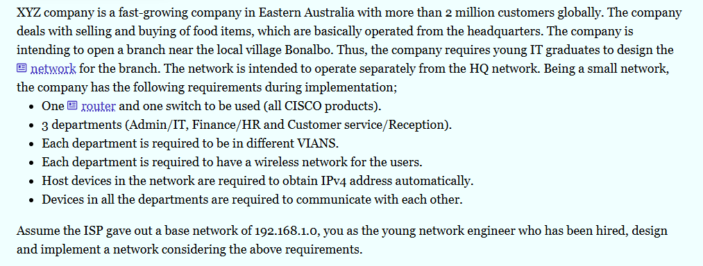

# **LAB 2** ~ Small Office Home Office/SOHO Network Design & Implementation

## 📌 Project Overview

This project focuses on designing and implementing a network infrastructure for XYZ Company, a fast-growing food trading company with more than 2 million customers globally.

As part of its business expansion, XYZ Company plans to establish a new branch office near the local village of Bonalbo, Eastern Australia. The company requires an independent network infrastructure for its new branch that operates separately from its headquarters (HQ).

The network is designed and simulated using Cisco Packet Tracer, incorporating VLAN segmentation, wireless connectivity, DHCP, and inter-VLAN routing to provide reliable communication between different departments.

## Case-study



## 🎯 Project Objectives

- Design a network infrastructure for the new branch office.
- Implement three separate VLANs for different departments.
- Provide wireless connectivity to all departments.
- Configure automatic IPv4 address allocation using DHCP.
- Enable communication between all departmental networks.
- Configure the network using Cisco networking devices.
- Maintain an independent network infrastructure from the HQ network.

## 🏢 Network Requirements

The network implementation follows these requirements:

- One Cisco router.
- One Cisco Layer 2 switch.
- Three departments:
  - Admin / IT
  - Finance / HR
  - Customer Service / Reception
- A separate VLAN for each department.
- One wireless access point for each department.
- Automatic IPv4 address allocation through DHCP.
- Inter-VLAN communication between all departments.

## 🏬 Departmental VLAN Configuration

The network is divided into three VLANs to provide logical separation between departments.

| Department | VLAN ID | Network Address |
|---|---|---|
| Admin / IT | 10 | 192.168.1.0/26 |
| Finance / HR | 20 | 192.168.1.64/26 |
| Customer Service / Reception | 30 | 192.168.1.128/26 |

### VLAN 10 – Admin / IT

- VLAN ID: 10
- Network: 192.168.1.0/26
- Default Gateway: 192.168.1.1
- Wireless Access Point: Access Point 0

Connected devices:
- PC0
- Laptop0
- Smartphone1
- Printer0

### VLAN 20 – Finance / HR

- VLAN ID: 20
- Network: 192.168.1.64/26
- Default Gateway: 192.168.1.65
- Wireless Access Point: Access Point 1

Connected devices:
- PC1
- Laptop1
- Smartphone0
- Printer1

### VLAN 30 – Customer Service / Reception

- VLAN ID: 30
- Network: 192.168.1.128/26
- Default Gateway: 192.168.1.129
- Wireless Access Point: Access Point 2

Connected devices:
- PC2
- Laptop2
- Smartphone2
- Tablet0
- Printer2

## 🌐 IP Addressing Scheme

The ISP has allocated the base network address `192.168.1.0/24`.

The network is divided into three subnets using a `/26` subnet mask (`255.255.255.192`).

| Parameter | VLAN 10 | VLAN 20 | VLAN 30 |
|---|---|---|---|
| Network Address | 192.168.1.0 | 192.168.1.64 | 192.168.1.128 |
| Subnet Mask | 255.255.255.192 | 255.255.255.192 | 255.255.255.192 |
| Default Gateway | 192.168.1.1 | 192.168.1.65 | 192.168.1.129 |
| First Usable IP | 192.168.1.1 | 192.168.1.65 | 192.168.1.129 |
| Last Usable IP | 192.168.1.62 | 192.168.1.126 | 192.168.1.190 |
| Broadcast Address | 192.168.1.63 | 192.168.1.127 | 192.168.1.191 |
| Usable Hosts | 62 | 62 | 62 |

## 🔀 VLAN Configuration

VLANs are configured on the Cisco 2960 switch to separate the three departments logically.

| VLAN ID | VLAN Name | Department |
|---|---|---|
| 10 | ADMIN_IT | Admin / IT |
| 20 | FINANCE_HR | Finance / HR |
| 30 | CUSTOMER_SERVICE | Customer Service |

Each departmental switch port is configured as an access port belonging to its respective VLAN.

The connection between the router and switch is configured as a trunk link to carry traffic from all three VLANs.

## 🚦 Inter-VLAN Routing

Inter-VLAN routing is implemented using the **Router-on-a-Stick** method.

A single physical interface on the Cisco 2911 router is divided into three logical subinterfaces. Each subinterface is assigned to a different VLAN and acts as its default gateway.

| Router Interface | VLAN | IP Address |
|---|---|---|
| G0/0.10 | 10 | 192.168.1.1 |
| G0/0.20 | 20 | 192.168.1.65 |
| G0/0.30 | 30 | 192.168.1.129 |

This configuration allows devices from different departments to communicate with each other through the router.

## 📡 DHCP Configuration

Dynamic Host Configuration Protocol (DHCP) is configured on the Cisco router to automatically assign IPv4 addresses to connected devices.

Three separate DHCP pools are created:

- Admin-Pool – 192.168.1.0/26
- Finance-Pool – 192.168.1.64/26
- CS-Pool – 192.168.1.128/26

Each DHCP pool provides:
- IP address
- Subnet mask
- Default gateway
- DNS server address

This eliminates the need for manually configuring IP addresses on individual devices.

## 📶 Wireless Network Configuration

The proposed network consists of a Cisco 2911 router connected to a Cisco 2960 switch. All departmental devices are connected to the central switch either directly or through wireless access points.
Each department has a dedicated wireless access point to provide wireless connectivity.

| Department | Access Point | VLAN | SSID |
|---|---|---|---|
| Admin / IT | Access Point 0 | 10 | Admin-WIFI |
| Finance / HR | Access Point 1 | 20 | Finance-WIFI |
| Customer Service | Access Point 2 | 30 | Customer-WIFI |

Wireless devices such as laptops, smartphones, and tablets connect to their respective departmental wireless networks.

Each access point is connected to the central switch, and its switch port is assigned to the corresponding departmental VLAN.

WPA2-PSK security is assigned to protect wireless communication.

## 🔗 Network Communication

Although each department operates in a separate VLAN, all departments are required to communicate with each other.

The Cisco 2911 router facilitates this communication through inter-VLAN routing.

Communication is enabled between:

- Admin / IT and Finance / HR.
- Admin / IT and Customer Service.
- Finance / HR and Customer Service.

Both wired and wireless devices can communicate across departments, subject to network and host security settings.

## 📂 Configuration Files

The Cisco device configurations are available in the following files:

- [Router Configuration](configurations/router-config.txt)
- [Switch Configuration](configurations/switch-config.txt)

These files contain the configurations used to implement VLANs,
inter-VLAN routing, DHCP, and network connectivity.

## 🧪 Network Testing and Verification

After implementing the network, the following tests can be performed in Cisco Packet Tracer.

### 1. Verify VLAN Configuration

```cisco
show vlan brief
```

### 2. Verify Trunk Configuration

```cisco
show interfaces trunk
```

### 3. Verify Router Interfaces

```cisco
show ip interface brief
```

### 4. Verify DHCP Allocation

```cisco
show ip dhcp binding
```

### 5. Test Network Connectivity

Use the following command from PCs to test connectivity:

```bash
ping 192.168.1.1
ping 192.168.1.65
ping 192.168.1.129
```

### 6. Test Inter-VLAN Communication

Perform ping tests between devices belonging to different departments to verify that inter-VLAN routing is working correctly.

### 7. Test Wireless Connectivity

- Connect wireless devices to their respective SSIDs.
- Verify automatic IP address allocation.
- Test connectivity to the default gateway.
- Test communication with devices in other VLANs.

### 🖥️ Final Network Topology


## 🛠️ Technologies and Tools Used

| Technology | Purpose |
|---|---|
| Cisco Packet Tracer | Network simulation |
| Cisco 2911 Router | Routing and DHCP |
| Cisco 2960 Switch | Switching and VLAN configuration |
| VLAN | Network segmentation |
| Router-on-a-Stick | Inter-VLAN routing |
| DHCP | Automatic IP allocation |
| IPv4 Subnetting | IP address management |
| Wireless Access Points | Wireless connectivity |
| WPA2-PSK | Wireless security |

## 📁 Project Structure

```text
SOHO-network-design/
│
├── README.md
│
├── topology/
│   └── topology-design.png
│
├── screenshots/
|   └── case-study.PNG
|
├── packet-tracer/
│   └── XYZ-Company-Network.pkt
│
└── configurations/
    ├── router-config.txt
    └── switch-config.txt
```

## 🚀 How to Run the Project

1. Clone or download this repository.
2. Install Cisco Packet Tracer.
3. Open the project folder.
4. Navigate to the `packet-tracer` directory.
5. Open `XYZ-Company-Network.pkt`.
6. Inspect the network topology and device configurations.
7. Test connectivity using ping commands.

## 📝 New Learnings from this project

1. VLANs seperate network logically.
2. VLAN is configured from Switch.
3. DHCP provides IP address automatically to the host devices

---

Created as a practical computer networking project using **Cisco Packet Tracer**.